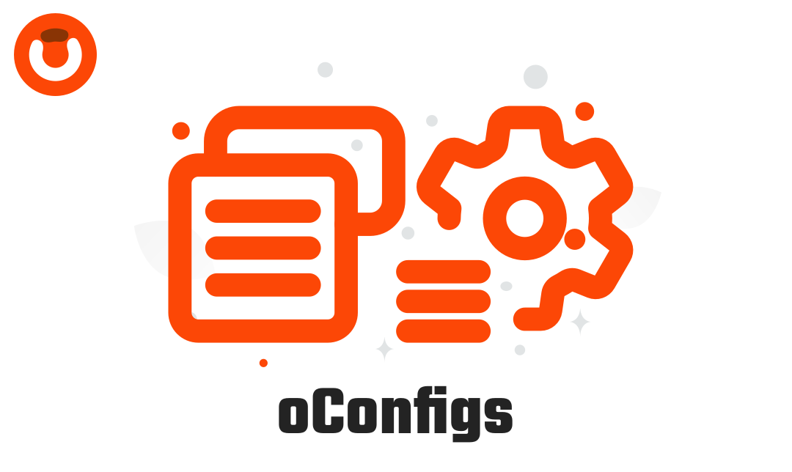

<p align="center"></p>

<p align="center">
  <a href="https://packagist.org/packages/obelaw/o-configs" target="_blank"></a>
  <a href="https://packagist.org/packages/obelaw/o-configs" target="_blank"></a>
</p>

# oConfigs Package

You can add and manage options within the configurations and overwrite the application configurations without having to change the values inside the configuration files.

## Documentation

You can find the detailed documentation here in [Documentation](https://obelaw.com/docs/2.x/packages/o-configs.html).

## Groups

Every value lives in one table, `o_configs` (`group`, `path`, `value`). The `group` says whose
value it is: `''` for the global values, or any key such as `App\Models\Tenant:5`.

```php
oconfig('shop.currency');                         // the current group
OConfig::set('shop.currency', 'EGP');             // written to the current group only

OConfig::group('App\Models\Tenant:5')->get('shop.currency');
OConfig::global()->get('shop.currency');
$tenant->configs()->get('shop.currency');         // HasConfigs: the model's group
```

Reads fall back to the global value, then to Laravel's `config()`, then to the default.
Writes never leave the group they were made in.

### Choosing the current group

`config/o-configs.php` (`php artisan vendor:publish --tag=o-configs-config`):

```php
'group_resolver' => Obelaw\Configs\Resolvers\GlobalGroupResolver::class,
'fallback_to_global' => true,
'connection' => env('OCONFIGS_CONNECTION'), // null = the model's connection
```

A resolver implements `Obelaw\Configs\Contracts\GroupResolver`:

```php
final class TenantGroupResolver implements GroupResolver
{
    public function current(): ?string
    {
        return Tenant::current()?->configGroup(); // null outside a tenant = global
    }
}
```

With it, every package that calls `oconfig()` keeps each tenant's values apart without knowing
about tenancy. In a database-per-tenant app, set `connection` to the central connection so the
table stays central.

The manager is a scoped binding: each request or queued job reads fresh values.

## Upgrading from 1.x

- Run `php artisan migrate`. It moves the global values to group `''` and every
  `o_config_models` row to group `{modelable_type}:{modelable_id}` (the key `HasConfigs`
  uses), then drops `o_config_models`. `migrate:rollback` restores the 1.x tables.
- `HasConfigs::allConfigs()` returns a query on `o_configs` instead of a `morphMany`, and
  `configs()` returns `Obelaw\Configs\Services\ConfigurationService`.
- Removed: `Obelaw\Configs\Models\ConfigModel` and `Obelaw\Configs\Services\ConfigurationModelService`.
- `oconfig()` with no argument returns `Obelaw\Configs\ConfigsManager`.

## Contributing

Thank you for considering contributing to this package! Be one of the Store team.

## License

This package is an open-sourced software licensed under the [MIT license](https://opensource.org/licenses/MIT).
